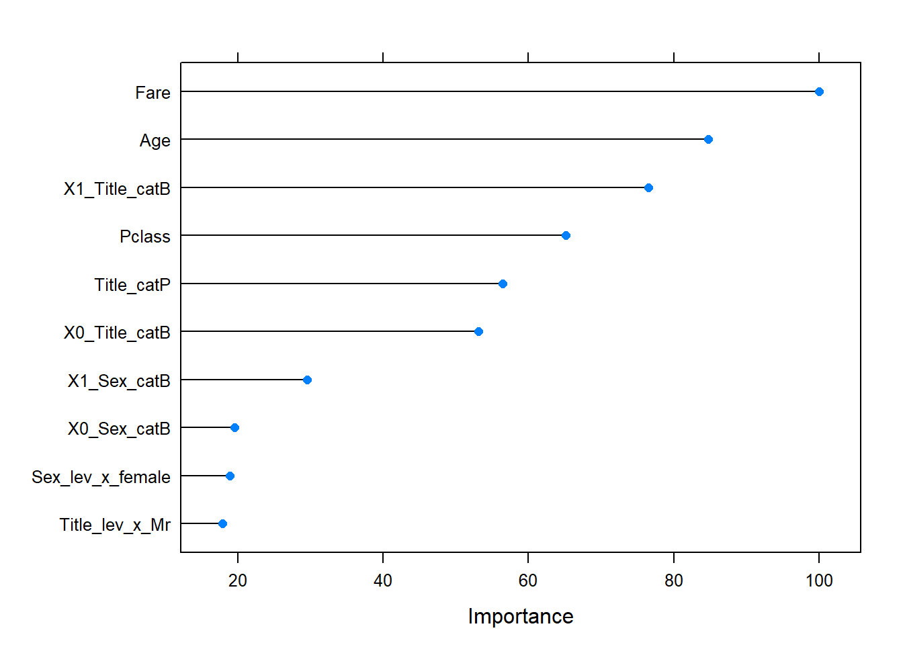

# Titanic Survival Prediction

> **Historical portfolio artifact:** this repository preserves the rendered R Markdown report. The standalone source file is not included.

**[▶ View the rendered report](https://raw.githack.com/izzydi/titanic-survival-prediction/main/titanic_survival_analysis.html)**

A classification analysis in R of the Kaggle Titanic training data (`train.csv`). It covers exploratory analysis, missing-value imputation, feature engineering (including passenger titles) and a caret Random Forest.

## Key results (from the report)

| Measure | Value |
|---|---|
| Model | Random Forest, 10-fold cross-validation repeated 5 times (`mtry = 5`) |
| Cross-validated accuracy | 0.831 |
| Hold-out accuracy (222 passengers) | 0.833 |
| Majority-class accuracy on the same set | 0.613 |
| Kappa | 0.64 |

Fare, age, passenger title and ticket class were the most important predictors.

Missing values were imputed and features engineered on the full dataset before the train/test split, so the hold-out estimate may be slightly optimistic.

## Repository contents

- [`titanic_survival_analysis.html`](titanic_survival_analysis.html) — rendered report with code, outputs and figures.
- [`figures/`](figures/) — figure exported unchanged from the report.

## Reproducibility note

The R code is shown inside the rendered report, but the standalone R Markdown file is not in the repository. The input data (Kaggle Titanic `train.csv`) are not included.
